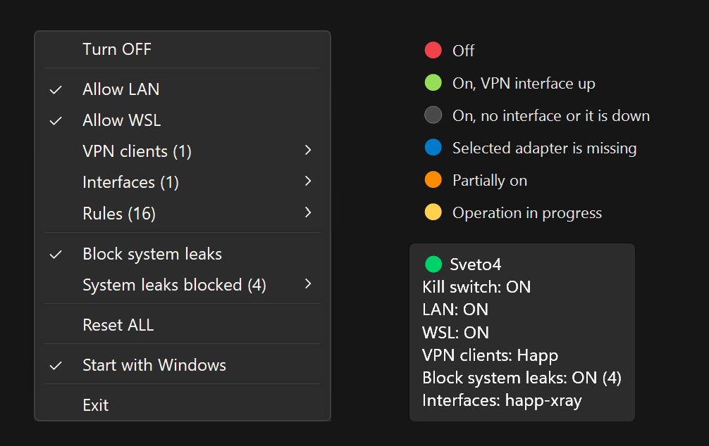

# Sveto4

**English** | [Русский](README.ru.md)



A VPN kill switch for Windows that lives in the system tray. It blocks all outbound traffic with Windows Firewall, except through the network interfaces you allow. It is meant for VPN clients that have no kill switch of their own, or one that is hard to set up. Tested with **Happ** (built-in profile), **NekoBox**, **INCY** and **AmneziaVPN** (sample profiles).

Written in C# for .NET Framework 4.8, which ships with Windows 10/11: nothing to install. The original PowerShell version is kept in `legacy/`.

## Features

- **Survives crashes and reboots.** Blocking lives in Windows Firewall itself, so it stays on after the app exits, crashes or the PC restarts, and it does not depend on the VPN client running.
- **VPN client profiles.** Happ is built in, others are imported as JSON. A profile allows the client's executables, so core switches (xray ↔ sing-box) and cores started later just work.
- **Automatic tunnel adapters.** A new TUN adapter, even with a random name like `tun_<random>`, is allowed as soon as it appears; a vanished one is removed.
- **System leak blocking.** Built-in Windows rules that can leak traffic (DNS, IPv6, Teredo, IP-HTTPS) are disabled while blocking and restored afterwards. Optional.
- **LAN and WSL toggles.** Allow LAN (including `fe80::/10`) and Allow WSL (via a Hyper-V firewall rule, not by allowing all system traffic).
- **Small and native.** One small exe on .NET Framework 4.8, built into Windows 10/11. Tray menu follows the light/dark theme; firewall profiles that disagree are shown as "partially on".

## Download and run

Download `sveto4.exe` from [Releases](../../releases) and put it in a folder only administrators can write to, for example `C:\Program Files\Sveto4\` (see [Security and limitations](#security-and-limitations)). The app asks for administrator rights.

- Only one copy runs at a time.
- `--auto-enable` turns the kill switch on at startup. "Start with Windows" does not use it.

### Build from source

Requires the .NET SDK 8+ (`winget install Microsoft.DotNet.SDK.8`):

```powershell
dotnet test        # unit tests, they never touch the real firewall
.\build.ps1        # builds dist\sveto4.exe (restarts it if it is running from dist)
```

| Path | Contents |
|---|---|
| `src/Sveto4/` | Application (C#, WinForms) |
| `tests/Sveto4.Tests/` | Unit tests (xUnit) |
| `docs/profiles/` | Sample VPN client profiles |
| `docs/` | Roadmap and the audit of the old version (in Russian) |
| `legacy/` | PowerShell version (reference only) |

## Tray menu

- **Turn ON / OFF**: blocks or allows outbound traffic by default in all firewall profiles (Domain, Private, Public).
- **Allow LAN**: allows private subnets (`192.168.0.0/16`, `10.0.0.0/8`, `172.16.0.0/12`, `fc00::/7`) and IPv6 link-local (`fe80::/10`).
- **Allow WSL**: lets WSL out through the Hyper-V firewall (rule `KS-WSL-Allow`, Windows 11 22H2+). WSL traffic then follows the same rules as Windows: it goes out only through the allowed interfaces (the VPN) and is blocked when the VPN is down.
- **VPN clients**: client profiles (see below). An enabled profile allows the client's executables and selects its tunnel adapters automatically, including adapters with random names that change on every connection.
- **Interfaces**: adapters that traffic may use (rule `KS-Allow-<name>`). Adapters managed by a profile are checked and greyed out, with the client name on the right. A selected adapter that is missing or disconnected is marked `⚠ Not found` / `⚠ Disconnected`; click it to deselect. **None** clears all interfaces and disables profiles.
- **Rules**: the app's firewall rules (prefix `KS-`), read-only.
- **Block system leaks**: while the kill switch is on, disables built-in Windows rules that let traffic bypass it (see [System leaks](#system-leaks)).
- **Reset ALL**: allows traffic and removes all `KS-*` rules. Does not touch autostart.
- **Start with Windows**: a Task Scheduler task that starts the app at logon with highest privileges (no UAC prompt). If the exe is moved, the task follows it on the next start.
- **Exit**: the kill switch **stays on** after exit or a crash. That is the point of a kill switch.

## VPN client profiles

**Happ** is built in. Other clients are added with **VPN clients → Import profile…** (a JSON file) and removed with **Remove profile ▸** (their rules are removed too). Samples: [`nekobox.json`](docs/profiles/nekobox.json) (NekoBox and other sing-box based clients), [`incy.json`](docs/profiles/incy.json), [`amneziavpn.json`](docs/profiles/amneziavpn.json) (AmneziaWG protocol), [`happ.json`](docs/profiles/happ.json) (the built-in profile as a file).

```json
{
  "id": "nekobox",
  "name": "NekoBox",
  "adapterDescriptions": ["sing-tun Tunnel"],
  "mainProcesses": ["nekobox.exe", "nekobox_core.exe"],
  "defaultInstallDirs": ["%APPDATA%\\NekoBox"],
  "allowExe": ["nekobox.exe", "nekobox_core.exe"]
}
```

| Field | Required | Meaning |
|---|---|---|
| `id` | yes | Lowercase latin letters and digits, up to 20. Used in rule names `KS-App-<id>-<exe>` |
| `name` | yes | Name shown in the menu |
| `adapterDescriptions` | yes* | Tunnel adapter descriptions (exact match; the " #N" Windows appends to duplicates is ignored). Use it when the adapter name is random |
| `adapterNamePrefixes` | yes* | Adapter name prefixes, at least 3 characters (`happ-`) |
| `mainProcesses` | no | Exe names used to find the client folder among running processes |
| `defaultInstallDirs` | no | Client folders when it is not running; environment variables allowed |
| `allowExe` | no | Allow **only** these executables (`*` patterns). Without it, every exe in the client folder is allowed |
| `excludeExe` | no | Never allow these executables (installers etc.) |

\* At least one of the two.

Profiles are stored in `%ProgramData%\Sveto4\profiles\`; the app makes `%ProgramData%\Sveto4` writable by administrators only. A drive root, `Windows`, `Program Files`, `ProgramData` or a user profile root is never accepted as a client folder.

## Tooltip

```
🟢 Sveto4
Kill switch: ON
LAN: OFF
WSL: OFF
VPN clients: Happ
Block system leaks: ON (4)
Interfaces: happ-xray, Wi-Fi
```

The circle repeats the icon color:

| Color | State |
|---|---|
| 🔴 Red | Off |
| 🟢 Green | On, a selected interface is up |
| ⚪ Grey | On with no interfaces, or the selected interface is down |
| 🔵 Blue | The selected adapter is missing |
| 🟠 Orange | Partially on: some firewall profiles do not block. Use **Turn ON / OFF (all profiles)**; `firewall disabled` means the firewall itself is off for that profile |
| 🟡 Yellow | An operation is in progress |

## System leaks

Built-in Windows Allow rules still work while outbound traffic is blocked. The app tracks four of them, recognized by their properties (so the Windows language does not matter): **DNS**, **IPv6 tunnel**, **Teredo** and **IP-HTTPS**.

- With **Block system leaks** on (default), they are disabled while the kill switch is on, remembered in `%ProgramData%\Sveto4\disabled-rules.txt` and re-enabled on Turn OFF / Reset ALL. Rules you disabled yourself are left alone. If Windows re-enables a rule, the app disables it again (at most every 5 minutes).
- With it off, the menu only warns: **Possible leaks (N)**.
- Side effect: if a VPN client resolves its server through Windows DNS, it cannot reconnect while the VPN is down. Turn the option off in that case.

## Security and limitations

- **The kill switch is built on Windows Firewall rules**, not on its own WFP filters. A program with administrator rights can add WFP filters and bypass it. sing-box based cores (NekoBox, INCY) do exactly that to reach their server. That is fine for a VPN client, but it also means the kill switch does not stop malware running as administrator.
- **A client profile grants network access to programs.** Import only profiles you understand. For clients in user-writable folders (`%APPDATA%`), use `allowExe`.
- **Autostart runs the exe with administrator rights and no UAC prompt.** Keep the app in a folder only administrators can write to, such as `C:\Program Files\Sveto4\`. Otherwise any program could replace `sveto4.exe` and gain administrator rights at the next logon.
- **The exe is not code-signed**, so SmartScreen may warn on first run. Release builds are produced by GitHub Actions from this repository's source.
- Only the four system rules above are handled. Other built-in Allow rules (Store, Remote Assistance, etc.) stay active.
- Client executable rules are created when the profile is enabled. If the client is reinstalled to another folder, disable and enable the profile again.

## Errors and log

The menu shows the expected result right after a click, then re-reads the real state from the firewall; if the operation failed, it shows the actual state. No error dialogs are shown: errors go to `%LOCALAPPDATA%\Sveto4\sveto4.log`, together with operation timings and adapters that appear after startup.

The menu follows the Windows light/dark app mode (Windows 10 1903+).

## License

[MIT](LICENSE).
