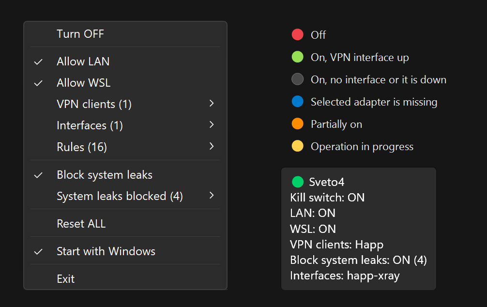

# Sveto4

**English** | [Русский](README.ru.md)



A VPN Kill Switch for Windows that lives in the system tray. It blocks all outbound traffic with Windows Firewall, except through the network interfaces you allow. It is meant for VPN clients that have no Kill Switch of their own, or one that is hard to set up. Tested with **Happ** (built-in profile), **NekoBox**, **INCY** and **AmneziaVPN** (sample profiles).

Written in C# for .NET Framework 4.8, which ships with Windows 10/11: nothing to install. The original PowerShell version is kept in `legacy/`.

## Features

- **Survives crashes and reboots.** Blocking lives in Windows Firewall itself, so it stays on after the app exits, crashes or the PC restarts, and it does not depend on the VPN client running.
- **VPN client profiles.** Happ is built in, others are imported as JSON. A profile allows the client's executables, so core switches (xray ↔ sing-box) and cores started later just work.
- **Automatic tunnel adapters.** A new TUN adapter, even with a random name like `tun_<random>`, is allowed as soon as it appears; a vanished one is removed.
- **System leak blocking.** Built-in Windows rules that can leak traffic (DNS, IPv6, Teredo, IP-HTTPS) are disabled while blocking and restored afterwards. Optional.
- **Exceptions.** Allow specific addresses past the Kill Switch, optionally for one program and port, e.g. SSH to the VPN server itself.
- **LAN and WSL toggles.** Allow LAN (including `fe80::/10`, without DNS to the router) and Allow WSL (via a Hyper-V firewall rule, not by allowing all system traffic).
- **Small and native.** One small exe on .NET Framework 4.8, built into Windows 10/11. Tray menu follows the light/dark theme; firewall profiles that disagree are shown as "partially on".

## Download and run

Download `sveto4.exe` from [Releases](../../releases) and put it in a folder only administrators can write to, for example `C:\Program Files\Sveto4\` (see [Security and limitations](#security-and-limitations)). The app asks for administrator rights.

- Only one copy runs at a time.
- `--auto-enable` turns the Kill Switch on at startup. "Start with Windows" does not use it.

### Build from source

Requires the .NET SDK 8+ (`winget install Microsoft.DotNet.SDK.8`):

```powershell
dotnet test        # unit tests, they never touch the real firewall
.\build.ps1        # builds dist\sveto4.exe (restarts it if it is running from dist)
```

| Path | Contents |
|---|---|
| `src/Sveto4/` | Application (C#, WinForms) |
| `tests/Sveto4.Tests/` | Unit tests (xUnit) |
| `docs/profiles/` | Sample VPN client profiles |
| `docs/` | Roadmap and the audit of the old version (in Russian) |
| `legacy/` | PowerShell version (reference only) |

## Tray menu

- **Turn ON / OFF**: blocks or allows outbound traffic by default in all firewall profiles (Domain, Private, Public).
- **Allow LAN**: allows private subnets (`192.168.0.0/16`, `10.0.0.0/8`, `172.16.0.0/12`, `fc00::/7`) and IPv6 link-local (`fe80::/10`) over TCP, UDP and ICMP (rules `KS-LAN-Allow-TCP`, `-UDP`, `-ICMPv4`, `-ICMPv6`). DNS ports 53 and 853 are excluded: Windows also asks the DNS servers of every adapter, so the router would resolve names past the VPN and the provider would see them. DNS through the tunnel is not affected, it is allowed by the VPN adapter rule. Side effects: a DNS server in your LAN (e.g. Pi-hole) and protocols other than TCP, UDP and ICMP are not reachable through Allow LAN. Rules of older versions (one per subnet) are replaced automatically.
- **Allow WSL**: lets WSL out through the Hyper-V firewall (rule `KS-WSL-Allow`, Windows 11 22H2+). WSL traffic then follows the same rules as Windows: it goes out only through the allowed interfaces (the VPN) and is blocked when the VPN is down.
- **VPN clients**: client profiles (see below). An enabled profile allows the client's executables and selects its tunnel adapters automatically, including adapters with random names that change on every connection.
- **Interfaces**: adapters that traffic may use (rule `KS-Allow-<name>`). Adapters managed by a profile are checked and greyed out, with the client name on the right. A selected adapter that is missing or disconnected is marked `⚠ Not found` / `⚠ Disconnected`; click it to deselect. **None** clears all interfaces and disables profiles.
- **Exceptions**: addresses allowed past the Kill Switch (see [Exceptions](#exceptions)).
- **Rules**: the app's firewall rules (prefix `KS-`), read-only.
- **Reset ALL**: removes all `KS-*` rules (interfaces, profiles, LAN, WSL, exceptions) and disables profiles and exceptions; their definitions are kept. The Kill Switch stays as it is: if it is on, all traffic stays blocked. System leak blocking and autostart are not touched.
- **Block system leaks**: while the Kill Switch is on, disables built-in Windows rules that let traffic bypass it (see [System leaks](#system-leaks)).
- **Other Allow rules (N)**: shown while the Kill Switch is on. Read-only list of enabled outbound Allow rules that programs added (not built into Windows, not the app's own). Each lets its program reach the network outside the VPN; disable the ones you do not need in Windows Defender Firewall (`wf.msc`).
- **Start with Windows**: a Task Scheduler task that starts the app at logon with highest privileges (no UAC prompt). If the exe is moved, the task follows it on the next start. If the exe is in a folder that programs without administrator rights can change, the item is marked `⚠ Writable folder` and turning it on asks for confirmation.
- **Exit**: the Kill Switch **stays on** after exit or a crash. That is the point of a Kill Switch.

## VPN client profiles

**Happ** is built in. Other clients are added with **VPN clients → Import profile…** (a JSON file) and removed with **Remove profile ▸** (their rules are removed too). Samples: [`nekobox.json`](docs/profiles/nekobox.json) (NekoBox and other sing-box based clients), [`incy.json`](docs/profiles/incy.json), [`amneziavpn.json`](docs/profiles/amneziavpn.json) (AmneziaWG protocol), [`happ.json`](docs/profiles/happ.json) (the built-in profile as a file).

```json
{
  "id": "nekobox",
  "name": "NekoBox",
  "adapterDescriptions": ["sing-tun Tunnel"],
  "mainProcesses": ["nekobox.exe", "nekobox_core.exe"],
  "defaultInstallDirs": ["%APPDATA%\\NekoBox"],
  "allowExe": ["nekobox.exe", "nekobox_core.exe"]
}
```

| Field | Required | Meaning |
|---|---|---|
| `id` | yes | Lowercase latin letters and digits, up to 20. Used in rule names `KS-App-<id>-<exe>` |
| `name` | yes | Name shown in the menu |
| `adapterDescriptions` | yes* | Tunnel adapter descriptions (exact match; the " #N" Windows appends to duplicates is ignored). Use it when the adapter name is random |
| `adapterNamePrefixes` | yes* | Adapter name prefixes, at least 3 characters (`happ-`) |
| `mainProcesses` | no | Exe names used to find the client folder among running processes |
| `defaultInstallDirs` | no | Client folders when it is not running; environment variables allowed |
| `allowExe` | no | Allow **only** these executables (`*` patterns). Without it, every exe in the client folder is allowed |
| `excludeExe` | no | Never allow these executables (installers etc.) |

\* At least one of the two.

Profiles are stored in `%ProgramData%\Sveto4\profiles\`; the app makes `%ProgramData%\Sveto4` writable by administrators only. A drive root, `Windows`, `Program Files`, `ProgramData` or a user profile root is never accepted as a client folder.

How the client folder is found: first the profile's `defaultInstallDirs`, then the folder of a running `mainProcesses` exe. A folder that programs without administrator rights can change (checked for the folder and every folder above it) is accepted only from `defaultInstallDirs` and only if the profile has `allowExe`. A folder found by a running process must be administrators-only: otherwise any program could name itself like the client and get network access. In an administrators-only folder, an exe that can itself be changed without administrator rights, or lies in such a subfolder, is not allowed (logged as `not allowed, … can be changed without administrator rights`).

## Exceptions

An exception allows traffic to specific addresses past the Kill Switch, through any adapter. The typical case is the VPN server itself: the VPN client reaches it outside the tunnel, so with the Kill Switch on, `ssh` to the server fails with `Permission denied` even while the VPN is connected.

**Exceptions → Add exception…** opens a window:

| Field | Required | Meaning |
|---|---|---|
| Name | yes | Shown in the menu; rule `KS-Exc-<name>` |
| Address | yes | IP addresses or subnets, comma-separated (`203.0.113.5`, `198.51.100.0/24`, IPv6). Host names are not supported. Subnets broader than `/8` (IPv4) or `/16` (IPv6) are refused |
| Program | no | Full path to an exe, e.g. `C:\Windows\System32\OpenSSH\ssh.exe`. Empty: any program |
| Protocol | no | Any, TCP or UDP |
| Ports | no | Remote ports with TCP/UDP: `22`, `80,443`, `8000-8100`. Empty: any port |

A new exception is enabled right away. Click it to turn it off or on; **Edit exception ▸** opens the same window to change it (an enabled exception stays enabled); **Remove exception ▸** deletes it. A program that no longer exists is marked `⚠ Not found`. Exceptions are stored in `%ProgramData%\Sveto4\exceptions.json` (administrators only).

## Tooltip

```
🟢 Sveto4
Kill Switch: ON
LAN: OFF
WSL: OFF
VPN clients: Happ
Block system leaks: ON (4)
Interfaces: happ-xray, Wi-Fi
```

The circle repeats the icon color:

| Color | State |
|---|---|
| 🔴 Red | Off |
| 🟢 Green | On, a selected interface is up |
| ⚪ Grey | On with no interfaces, or the selected interface is down |
| 🔵 Blue | The selected adapter is missing |
| 🟠 Orange | Partially on: some firewall profiles do not block. Use **Turn ON / OFF (all profiles)**; `firewall disabled` means the firewall itself is off for that profile |
| 🟡 Yellow | An operation is in progress |

## System leaks

Built-in Windows Allow rules still work while outbound traffic is blocked. The app tracks four of them, recognized by their properties (so the Windows language does not matter): **DNS**, **IPv6 tunnel**, **Teredo** and **IP-HTTPS**.

- With **Block system leaks** on (default), they are disabled while the Kill Switch is on, remembered in `%ProgramData%\Sveto4\disabled-rules.txt` and re-enabled on Turn OFF. Rules you disabled yourself are left alone. If Windows re-enables a rule, the app disables it again (at most every 5 minutes).
- With it off, the menu only warns: **Possible leaks (N)**.
- Side effect: if a VPN client resolves its server through Windows DNS, it cannot reconnect while the VPN is down. Turn the option off in that case.

## Security and limitations

- **The Kill Switch is built on Windows Firewall rules**, not on its own WFP filters. A program with administrator rights can add WFP filters and bypass it. sing-box based cores (NekoBox, INCY) do exactly that to reach their server. That is fine for a VPN client, but it also means the Kill Switch does not stop malware running as administrator.
- **An exception opens addresses past the VPN.** Traffic to them goes outside the tunnel and reveals your real IP to that host. Limit it to a program and port where you can.
- **A client profile grants network access to programs.** Import only profiles you understand. For clients in user-writable folders (`%APPDATA%`), use `allowExe`.
- **Add profiles only with Import profile…, do not copy or move files into `%ProgramData%\Sveto4` by hand.** A file moved into a folder keeps the permissions of its old location, for example full access for your account on the Desktop. Until the permissions are fixed, any program running as you, without administrator rights, can rewrite it: add an exe to a profile or change the settings. Import reads the file and writes a new one with the folder's permissions. The app also checks every file before reading it and resets loose permissions (logged as `Permissions reset`), but it cannot tell whether the file was changed before that.
- **Autostart runs the exe with administrator rights and no UAC prompt.** Keep the app in a folder only administrators can write to, such as `C:\Program Files\Sveto4\`. Otherwise any program could replace `sveto4.exe` and gain administrator rights at the next logon.
- **The exe is not code-signed**, so SmartScreen may warn on first run. Release builds are produced by GitHub Actions from this repository's source.
- **Any enabled outbound Allow rule bypasses the Kill Switch**, because Windows Firewall applies it on every interface. Only the four system rules above are disabled automatically; other built-in Allow rules (Store, Remote Assistance, etc.) stay active, and rules added by programs are listed under **Other Allow rules** but not changed.
- Client executable rules follow the client folder: when an update adds, removes or moves an exe, the rules are updated within about 30 seconds (logged as `executable rules: +[…] -[…]`). A client that was uninstalled keeps its rules until the profile is turned off.

## Errors and log

The menu shows the expected result right after a click, then re-reads the real state from the firewall; if the operation failed, it shows the actual state. No error dialogs are shown: errors go to `%ProgramData%\Sveto4\sveto4.log` (administrators-only folder, readable by everyone), together with operation timings and adapters that appear after startup.

The menu follows the Windows light/dark app mode (Windows 10 1903+).

## License

[MIT](LICENSE).
