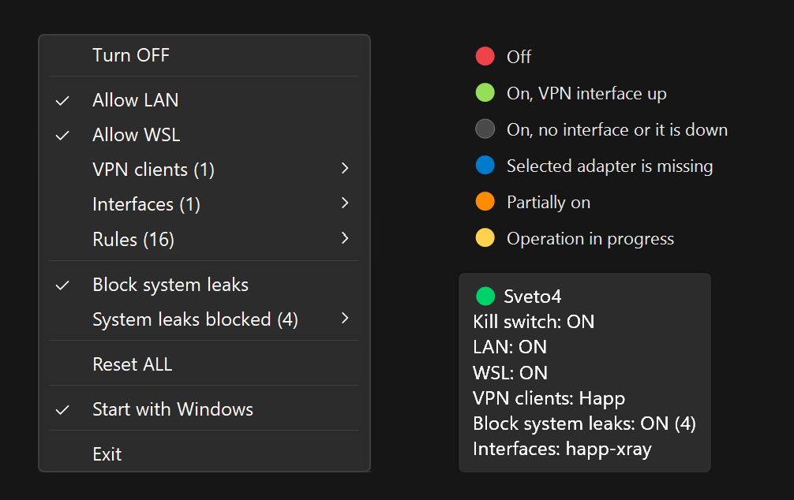

# Sveto4

[English](README.md) | **Русский**



VPN kill switch для Windows в системном трее. Блокирует весь исходящий трафик через Windows Firewall, кроме разрешённых сетевых интерфейсов. Нужен для VPN-клиентов, в которых своего kill switch нет или он сложно настраивается. Проверялся с **Happ**, для него есть готовый профиль клиента.

Версия 2 написана на C# (.NET Framework 4.8, встроен в Windows 10/11, ничего устанавливать не нужно). Прежняя PowerShell-версия лежит в `legacy/`.

## Возможности

- **Переживает падения и перезагрузки.** Блокировка хранится в самом файрволе Windows: она остаётся после выхода или падения программы и после перезагрузки и не зависит от того, запущен ли VPN-клиент.
- **Профили VPN-клиентов.** Happ встроен, другие импортируются из JSON. Профиль разрешает exe клиента, поэтому смена ядра (xray ↔ sing-box) и ядро, запущенное позже, работают без ручных действий.
- **Адаптеры туннеля подхватываются сами.** Новый TUN-адаптер, даже со случайным именем вроде `tun_<random>`, разрешается сразу после появления, пропавший удаляется.
- **Блокировка системных утечек.** Встроенные правила Windows, через которые возможны утечки (DNS, IPv6, Teredo, IP-HTTPS), отключаются на время блокировки и восстанавливаются после. Можно выключить.
- **Переключатели LAN и WSL.** Allow LAN (включая `fe80::/10`) и Allow WSL (через правило файрвола Hyper-V, а не пропуском всего системного трафика).
- **Маленький и встроенный.** Один небольшой exe на .NET Framework 4.8, который входит в Windows 10/11. Меню в трее следует светлой или тёмной теме; расхождение профилей файрвола показывается как «частично включено».

## Структура

| Путь | Назначение |
|---|---|
| `Sveto4.sln` | Решение: приложение и тесты |
| `src/Sveto4/` | Исходный код приложения (C#, WinForms) |
| `tests/Sveto4.Tests/` | Юнит-тесты (xUnit), файрвол не затрагивают: `dotnet test` |
| `build.ps1` | Сборка: `dist\sveto4.exe`; если программа из `dist` запущена, перезапускает её |
| `docs/` | Документация: [ROADMAP](docs/ROADMAP.md), [аудит старой версии](docs/AUDIT.md) |
| `legacy/` | PowerShell-версия (образец, не развивается) |

## Сборка и запуск

Готовый `sveto4.exe` можно скачать на странице [Releases](../../releases). Для сборки из исходников нужен .NET SDK 8+ (`winget install Microsoft.DotNet.SDK.8`):

```powershell
.\build.ps1
```

Запуск: `dist\sveto4.exe`. Программа запрашивает права администратора. Ключ `--auto-enable` сразу включает блокировку при старте. Пункт «Start with Windows» его не использует.

Одновременно может работать только одна копия. Старую PowerShell-версию перед запуском нужно закрыть. Правила файрвола у версий общие: новая подхватывает то, что настроила старая.

## Меню в трее

- **Turn ON / OFF**: у всех профилей файрвола (Domain, Private, Public) исходящий трафик по умолчанию блокируется или разрешается.
- **Allow LAN**: разрешает частные подсети (`192.168.0.0/16`, `10.0.0.0/8`, `172.16.0.0/12`, `fc00::/7`) и локальные адреса IPv6 (`fe80::/10`). Если подсеть добавлена в новой версии, а LAN уже включён, недостающее правило создаётся автоматически.
- **Allow WSL**: выпускает WSL в сеть. Создаёт правило `KS-WSL-Allow` в файрволе Hyper-V, через который проходит трафик WSL (Windows 11 22H2+). Дальше трафик WSL подчиняется тем же правилам, что и Windows: идёт только через выбранные интерфейсы (VPN), а при упавшем VPN блокируется. Если WSL не установлен, пункт неактивен с пометкой `not installed`. Прежний пункт «Allow NAT (WSL)» разрешал весь трафик процесса `System` через любой адаптер, то есть мимо VPN. Его правило `KS-NAT-Allow` при запуске удаляется, а если оно было включено, вместо него включается «Allow WSL».
- **Block system leaks**: на время блокировки отключать системные правила, через которые трафик может идти мимо VPN (см. «Системные утечки»).
- **VPN clients**: профили VPN-клиентов: встроенный **Happ** и импортированные (см. «Профили VPN-клиентов»). Включённый профиль разрешает все exe из папки клиента (кроме установщиков `unins*.exe`, `vc_redist*.exe`), в том числе ядра, которые ещё не запущены (`xray`, `sing-box`, `tun2proxy`), — правила `KS-App-happ-<exe>`. Папка берётся у запущенного Happ, иначе `%ProgramFiles%\FlyFrogLLC\Happ`. Адаптеры клиента (описание `Happ Tunnel` или имя `happ-…`) разрешаются автоматически: новый адаптер после смены ядра добавляется примерно за секунду, пропавший удаляется. Если клиент не найден, справа пометка `⚠ Not found`.
- **Interfaces**: адаптеры, через которые трафик разрешён (правило `KS-Allow-<имя>`). Адаптеры, которыми управляет профиль, отмечены и неактивны, справа имя клиента. Выбранный вручную адаптер, которого нет в системе или который отключён, помечается справа `⚠ Not found` или `⚠ Disconnected`; щелчок по нему снимает выбор. **None** снимает все интерфейсы и выключает профили клиентов. Служебные адаптеры в списке не показываются: WAN Miniport, Teredo, Wi-Fi Direct, а также внутренние адаптеры Hyper-V `vEthernet (WSL …)` и `vEthernet (Default Switch)`. Трафик WSL и виртуальных машин выходит в интернет через основные адаптеры. Адаптер внешнего коммутатора Hyper-V показывается: через него может идти основное подключение.
- **Rules**: список правил программы (префикс `KS-`), только просмотр.
- **Reset ALL**: разрешает трафик и удаляет все правила `KS-*`, в том числе `KS-WSL-Allow`. Автозапуск не трогает.
- **Start with Windows**: автозапуск через задачу Планировщика `Sveto4`. Задача запускается при входе текущего пользователя с наивысшими правами, поэтому окна UAC нет. Блокировку она сама не включает: состояние файрвола и так сохраняется после перезагрузки. Если exe переместили, при следующем запуске задача переключится на новый путь. Если задача запускает другую существующую копию программы, справа пометка `other copy`, щелчок переключает задачу на эту копию. Если файла из задачи нет, справа пометка `⚠ Not found`.
- **Exit**: выход. Блокировка при этом **остаётся включённой**: kill switch должен защищать, даже если программа закрыта или упала.

## Профили VPN-клиентов

Встроен профиль **Happ**. Другие клиенты подключаются импортом профиля: **VPN clients → Import profile…**, файл JSON. Образцы лежат в [`docs/profiles/`](docs/profiles/): [`nekobox.json`](docs/profiles/nekobox.json) для NekoBox и других клиентов на sing-box, [`incy.json`](docs/profiles/incy.json) для INCY, а [`happ.json`](docs/profiles/happ.json) показывает встроенный профиль в виде файла. Удаление: **Remove profile ▸** (правила профиля удаляются вместе с ним).

| Поле | Обязательное | Что значит |
|---|---|---|
| `id` | да | Латиница в нижнем регистре и цифры, до 20 символов. Используется в именах правил `KS-App-<id>-<exe>` |
| `name` | да | Название в меню |
| `adapterDescriptions` | да* | Описания туннельного адаптера (точное совпадение). Подходит, если имя адаптера случайное, как `tun_jvvrwugzd` у NekoBox |
| `adapterNamePrefixes` | да* | Начало имени адаптера, от 3 символов (`happ-`) |
| `mainProcesses` | нет | Имена exe, по которым ищется папка клиента среди запущенных программ |
| `defaultInstallDirs` | нет | Папки клиента, если он не запущен; можно `%APPDATA%`, `%ProgramFiles%` и т.п. |
| `allowExe` | нет | Разрешить **только** эти exe (шаблоны с `*`). Без поля разрешаются все exe из папки клиента |
| `excludeExe` | нет | Никогда не разрешать эти exe (установщики и т.п.) |

\* Нужно хотя бы одно из двух полей.

Безопасность:
- Профиль решает, каким программам открыть сеть в обход блокировки. Поэтому профили хранятся в `%ProgramData%\Sveto4\profiles\`, а менять папку `%ProgramData%\Sveto4` могут только администраторы.
- Если клиент лежит в папке, куда может писать любая программа (например, `%APPDATA%`), укажите `allowExe`. Иначе любой exe, подброшенный в эту папку, получит доступ в сеть.
- Папка клиента не может быть корнем диска, `Windows`, `Program Files`, `ProgramData` или корнем профиля пользователя. Такие папки отклоняются и при импорте, и когда папка определяется по запущенному процессу.

Адаптеры, выбранные профилем, программа запоминает (`settings.txt`). Поэтому пропавший адаптер снимается, даже если профиль узнаёт адаптеры только по описанию.

## Подсказка

При наведении на иконку:

```
🟢 Sveto4
Kill switch: ON
LAN: OFF
WSL: OFF
VPN clients: Happ
Block system leaks: ON (4)
Interfaces: happ-xray, Wi-Fi
```

Кружок перед названием повторяет цвет иконки (см. «Цвета иконки»). `Block system leaks`: `ON (N)` — отключено N системных правил; `ON, N open` — N правил открыто (не удалось отключить); `OFF` — переключатель выключен. Длинный список интерфейсов обрезается с `…` (предел Windows — 127 символов).

## Цвета иконки

| Цвет | Состояние |
|---|---|
| 🔴 Красный | Выключен |
| 🟢 Зелёный | Включён, выбранный интерфейс работает |
| ⚪ Серый | Включён без интерфейсов, или выбранный интерфейс отключён |
| 🔵 Синий | Выбранного адаптера нет в системе |
| 🟠 Оранжевый | Включён частично (см. ниже) |
| 🟡 Жёлтый | Идёт операция |

## Частичное включение

Если одни профили файрвола блокируют трафик, а другие нет, программа показывает оранжевую иконку. В меню появляется строка «Partially on. Not blocked: …» со списком незаблокированных профилей. Так бывает, если настройки файрвола изменили вручную, другой программой или обновлением Windows.

Что делать:
- **Turn ON (all profiles)**: заблокировать во всех профилях;
- **Turn OFF (all profiles)**: разрешить во всех профилях;
- если в списке есть пометка `firewall disabled`, значит, для этого профиля файрвол выключен целиком. Включите его в «Безопасность Windows → Брандмауэр и защита сети», иначе блокировка в этом профиле не работает.

## Тема меню

Меню следует режиму приложений Windows (Параметры → Персонализация → Цвета): в тёмном режиме оно тёмное. Используются недокументированные функции Windows 10 1903+; если они недоступны, меню остаётся светлым.

## Ошибки

После щелчка меню сразу показывает ожидаемый результат (галочку и т.п.), пока операция идёт в фоне (иконка жёлтая). Затем состояние перечитывается из файрвола; если операция не удалась, меню вернётся к фактическому состоянию, а ошибка будет в журнале.

Окна с ошибками программа не показывает. Ошибки записываются в журнал `%LOCALAPPDATA%\Sveto4\sveto4.log`. Временные сбои после выхода из сна пропускаются, и состояние перечитывается при следующем опросе (раз в 3 секунды). В журнал также пишется длительность каждой операции и адаптеры, появившиеся после запуска программы (`New adapter: …`).

## Безопасность и ограничения

- **Kill switch построен на правилах Windows Firewall**, а не на собственных фильтрах WFP. Программа с правами администратора может поставить свои фильтры WFP и выйти в сеть в обход блокировки. Так, например, делают ядра на sing-box (NekoBox, INCY): ядро подключается к серверу без правил Sveto4. Для VPN-клиента это нормально, но от вредоносной программы с правами администратора kill switch не защищает.
- **Профиль клиента открывает сеть программам.** Импортируйте только профили, которые понимаете. Для клиентов в папках, доступных на запись (`%APPDATA%`), указывайте `allowExe`.
- **Автозапуск запускает exe с правами администратора без UAC.** Держите программу в папке, куда может писать только администратор, например `C:\Program Files\Sveto4\`. Иначе любая программа сможет подменить `sveto4.exe` и получить права администратора при следующем входе.
- **exe не подписан** цифровой подписью, поэтому Windows SmartScreen может предупреждать при первом запуске. Собранные релизы публикует GitHub Actions из исходного кода этого репозитория.
- **Утечки через системные правила Windows** закрываются только для DNS, IPv6, Teredo и IP-HTTPS (см. «Системные утечки»). Другие встроенные разрешающие правила (Store, удалённый помощник и т.п.) действуют и при блокировке.
- Правила для exe клиента создаются при включении профиля. Если клиент переустановят в другую папку, выключите и снова включите профиль.

## Лицензия

[MIT](LICENSE).

## Системные утечки

Встроенные разрешающие правила Windows действуют и при включённой блокировке. Программа отслеживает 4 из них: **DNS** (запросы имён сайтов могут уходить провайдеру мимо VPN), **IPv6-туннель**, **Teredo** и **IP-HTTPS**. Правила распознаются по свойствам, поэтому язык Windows не важен.

- **Block system leaks** (переключатель в меню, включён по умолчанию): на время блокировки программа отключает эти правила и запоминает их в `%ProgramData%\Sveto4\disabled-rules.txt`. При **Turn OFF** или **Reset ALL** включает обратно только их. Правила, которые вы отключили сами, не трогаются. Если Windows снова включит правило, программа отключит его повторно (не чаще раза в 5 минут). В меню виден пункт **«System leaks blocked (N)»**.
- Если переключатель выключен, правила не меняются, а в меню появляется предупреждение **«Possible leaks (N)»**.
- **Возможный побочный эффект:** если VPN-клиент ищет адрес своего сервера через DNS Windows, то при упавшем VPN он не сможет переподключиться, пока блокировка включена. В этом случае снимите «Block system leaks».
- После выхода или падения программы правила остаются отключёнными, как и сама блокировка. Восстановить вручную можно в «Мониторе брандмауэра Защитника Windows» (`wf.msc`) → «Правила для исходящего подключения». Подробнее в [AUDIT.md](docs/AUDIT.md), п. 1.
